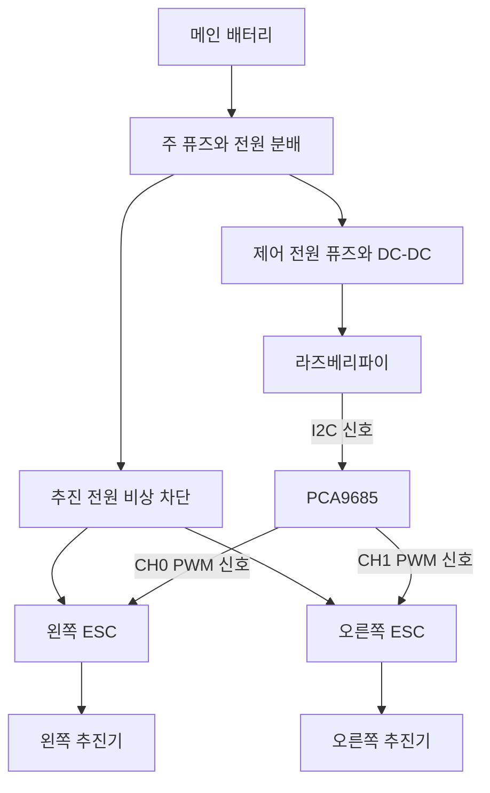

# 보트 모터 노드 v2 — Raspberry Pi + PCA9685

작성: 2026-10-20. 사용자 제공 배치도 4장을 반영했다.
**제어 경로는 Pi → I²C → PCA9685 → ESC 2개 → 추진기 2개다.** 이 버전은 Uno를 모터 PWM 출력에 사용하지 않는다.
기존 Uno가 있다면 초음파 등 기존 용도를 유지할 수 있으며 이 패키지가 그 펌웨어를 변경하지 않는다.
사진은 설명용 도식이므로 실제 ESC 제품명/사양이 확인된 것으로 취급하지 않는다.

## 배치도에 맞춘 연결 구조



실제 전력 공급 방향은 **배터리 → ESC → 모터**다. PCA9685는 모터 전력 공급 장치가 아니다.
제어 전원 분기는 배치도 취지에 맞춰 표시했다. 퓨즈 정격·전선 굵기·분배/차단 회로는 실제 배터리와 ESC 정격을 확인해 선정해야 한다.
Pi는 정격에 맞춘 안정적인 DC-DC 전원과 적절한 전원 입력 경로를 사용한다. ESC의 BEC 전원을 Pi GPIO에 바로 연결하지 않는다.

## 신호 배선 계획 (Pi 4의 물리 핀 번호)

| 출발 | 도착 | 비고 |
|---|---|---|
| Pi 1번, 3.3V | PCA9685 VCC | 로직 전원. V+와 구분 |
| Pi 3번, GPIO2/SDA1 | PCA9685 SDA | I²C 데이터 |
| Pi 5번, GPIO3/SCL1 | PCA9685 SCL | I²C 클록 |
| Pi 6번, GND | PCA9685 GND | 신호 기준 |
| PCA9685 CH0의 PWM/S | 왼쪽 ESC 신호 입력 | 코드에서 left.channel=0 |
| PCA9685 CH1의 PWM/S | 오른쪽 ESC 신호 입력 | 코드에서 right.channel=1 |
| PCA9685 GND | 좌·우 ESC 신호 GND | 비절연 신호 방식의 공통 기준. 실제 매뉴얼 확인 |
| Pi 11번, BCM17 | PCA9685 OE | HIGH=출력 차단. 아래의 기본 차단 회로가 별도로 필요 |

- 위 연결은 Adafruit 방식 PCA9685 보드의 핀 표기를 기준으로 한 **계획**이다. 보유 보드 실크/회로와 ESC의 3.3V 신호 수용 여부를 확인한다.
- 이 구성의 ESC 제어에는 PWM과 신호 GND를 사용한다. ESC의 BEC +5V 선을 두 개 서로 묶거나 PCA9685 VCC/Pi GPIO에 연결하지 않는다. 사용하지 않는 BEC 선은 절연한다.
- PCA9685 V+는 서보 전원 분배 레일이다. 이 ESC 신호 구성에서는 비워 두며 메인 배터리와 연결하지 않는다.
- OE는 보드에 기본 풀다운이 있을 수 있다. **Pi 부팅/정지/핀 해제 때도 OE가 HIGH가 되도록** 보드 회로를 확인해 외부 기본 차단 회로를 구성·측정해야 한다. GPIO 연결만으로 이를 보장하지 않는다.
- 비상 전원 차단은 OE와 별개다. OE는 PWM 신호를 막을 뿐 추진 전원을 차단하지 않는다.
- 이 코드가 초기화 시 모든 채널과 공통 PWM 주파수를 설정하므로 PCA9685 보드는 ESC 전용으로 쓴다.

## ESC를 두 종류로 나눈 이유

사진 속 '30A'는 전류 표시일 뿐 정지 펄스나 역회전 기능을 알려주지 않는다.
이전 준비본의 1500us 중립을 이 ESC에 그대로 적용할 수 없다.

| 설정 | 지원 방식 | 좌회전 계산 | 정지 펄스 |
|---|---|---|---|
| forward_only | 전진 전용 | 왼쪽을 낮추고 오른쪽을 높임. 후진 명령은 거부/해제 | 실제 매뉴얼로 입력 |
| bidirectional | 양방향 | 필요하면 왼쪽 역추력·오른쪽 정추력 | 실제 매뉴얼로 입력 |

전진 전용에서 yaw만 입력하면 왼쪽 정지·오른쪽 전진 식으로 돈다. 선체 중심 제자리 회전은 보장하지 않는다.
두 모드 모두 명령은 실제 속도/추력의 피드백 제어가 아니다.

예제 JSON은 **미리보기 계산용**이다:
- `preview_forward_only.json`: 1000us 정지, 2000us 전진 끝점, 50Hz라는 가상 예제. 사용자의 ESC 사양이 아님.
- `preview_bidirectional.json`: 1100/1500/1900us, 50Hz 참고 예제. 사용자 ESC 사양이 아님.
- `hardware_profile_template.json`: 사양 미확정 항목을 null/unconfigured로 둠. 실제 값 입력 전 실행 거부.

양쪽 ESC의 neutral/forward/reverse 값과 채널은 따로 설정할 수 있다. 두 ESC는 PCA9685의 공통 PWM 주파수를 함께 사용한다.
양방향 ESC의 sign=-1은 한쪽 물리 추진 방향이 반대일 때 사용할 보정이다. 전진 전용에 sign=-1은 허용하지 않는다.
시동 펄스부터 최대 스로틀을 자동 송출하는 캘리브레이션 루틴은 넣지 않았다.

## 포함 파일

- `boat_motor_node.py`: ROS 2 인터페이스와 preview/PCA9685 선택.
- `motor_core.py`: 좌우 혼합, 정지·허용 상태, 출력 상승 제한.
- `pca_backend.py`: PCA9685 I²C 출력, OE 차단, 초기 중립 유지, 오류 처리.
- `esc_config.py`: ESC 사양 검증, 펄스 폭과 duty cycle 변환.
- `preview_demo.py`: 하드웨어가 없는 preview 노드에만 전진·좌·우 명령을 보내는 예제.
- JSON 3개: 예제 2개와 실제 사양 입력 템플릿.
- 테스트 2개 및 `requirements-hardware.txt`.

## ROS 인터페이스

| 이름 | 타입 | 역할 |
|---|---|---|
| /boat/cmd_vel | geometry_msgs/msg/Twist | linear.x 전진, angular.z 왼쪽 회전 양수 |
| /boat/arm | std_srvs/srv/SetBool | true 허용 / false 정지·해제 |
| /boat/estop | std_msgs/msg/Bool | true 소프트웨어 비상정지 잠금 |
| /boat/reset_estop | std_srvs/srv/Trigger | 입력 해제 후 잠금 리셋. 자동 arm 없음 |
| /boat/motor_preview | std_msgs/msg/Float32MultiArray | [좌 논리 명령, 우 논리 명령, 좌 목표 us, 우 목표 us] |
| /boat/motor_status | std_msgs/msg/String | JSON 상태, ESC mode 포함 |

기존 터틀봇 `/cmd_vel`과 별도다. 회피 노드는 AUTO 후보 토픽 `/boat/auto/cmd_vel`에 발행한다. 통합 구성에서 `/boat/cmd_vel`의 단독 발행자는 `kaboat_control`이다.
터틀봇 주행 코드의 OpenCR 배터리 토픽 의존성과 차체 안전 조건도 보트에 맞게 바꿔야 한다.

## 기본 동작

- 시작 시 DISARMED. 최근 0.5초 내 정지 Twist와 단일 발행자를 확인한 후 arm.
- linear.x / 0.30, angular.z / 0.60으로 정규화한 뒤 좌=전진-회전, 우=전진+회전으로 혼합.
- 전진 전용이면 음의 개별 출력을 0으로 제한. 입력 linear.x<0 자체는 거부하고 해제.
- 좌우 비율을 유지하며 PWM 명령 범위를 최대 15%로 제한. **전력·추력 15% 또는 특정 선속이라는 뜻이 아니다.**
- 명령 0.5초 끊김, 잘못된 값, 다중 발행자 발견 시 정지·해제. 다시 명령만 들어온다고 재출발하지 않는다.
- 정지/estop는 상승 제한을 거치지 않고 중립 명령. 수상에서 선체 관성이 즉시 없어지는 것은 아니다.
- 하드웨어 모드에서는 arm 허용 시 중립 출력을 시작하고 neutral_init_seconds 경과 후 이동 명령을 적용합니다.
- I²C 출력 오류 시 OE HIGH, 오류 잠금 및 종료. Ctrl+C/정상 종료 시 중립을 요청하고 OE를 HIGH로 전환.

**PCA9685는 Pi 프로세스가 강제 종료되거나 멎어도 마지막 PWM을 계속 만들 수 있다.**
0.5초 명령 감시는 노드가 살아 있을 때만 작동한다. Uno 버전의 독립 MCU watchdog은 이 버전에 존재하지 않는다.
따라서 별도의 추진 전원 비상 차단과, OE/신호 상실에 대한 실제 ESC 정지 반응 확인이 필요하다.
무인 운용 전에 외부 heartbeat watchdog 등 독립 자동 차단도 설계·검증해야 한다. Pi GPIO 하나를 연결한 것만으로 대체하지 않는다.

## 워크스페이스 PREVIEW

`source ~/kaboat_ws/install/setup.bash` 후 `ros2 run kaboat_motor boat_motor`는 기본 양방향 PREVIEW로 시작합니다.
양방향 PREVIEW와 PCA는 같은 제어기를 사용합니다. 기본 PREVIEW에서 각 측의 음의 논리 출력 하한은 −0.04이고 방향 전환 중립 시간은 0.40초입니다. 양방향 실물 프로파일에는 실제 ESC 사양과 계측에 따른 `reverse_limit`(0 초과, 0.04 이하)과 `neutral_dwell_seconds`(0.40초 이상)를 명시합니다. 두 값은 각각 정규화된 명령 크기와 시간입니다. [정지 벤치 측정표](../../docs/records/bench-stop.md)
수동·자율 통합에서는 kaboat_control이 /boat/cmd_vel을 단독 발행합니다.
preview_demo.py는 별도 단독 시험에 사용합니다.

## 실제 하드웨어 단계 (오늘 확인된 사항 아님)

1. 실제 ESC 모델명, 전진/양방향 모드, 정지/끝점 펄스, PWM 주파수, 초기화 절차, 신호 허용 전압을 확인한다.
2. 템플릿을 `esc_actual.json`으로 복사하여 값을 입력한다. 예제 숫자를 그대로 실제 사양으로 확정하지 않는다.
3. OE 기본 차단 회로, 독립 추진 전원 차단, 신호 상실 시 정지를 확인한 후 해당 verified 항목을 true로 기록한다.
4. 인터넷이 가능한 환경에서 Pi의 Python/ROS 버전에 맞는 가상환경에 하드웨어 의존성을 설치한다. Pi I²C를 활성화하고 사용 권한을 확인한다. 네트워크/라이브러리 설치는 이 작업에서 수행하지 않았다.
5. 모터 전력을 차단한 상태에서 CH0/CH1 중립 펄스 폭과 주파수, OE 출력을 계측한다. 내부 오실레이터 편차가 있으므로 필요하면 reference_clock_hz를 보정한다.
6. 실측·배선이 확인된 뒤에만 20초 제한으로 실제 모터 시험을 진행한다. 모터별 수중 운전 조건은 제조사 기준을 따른다.

하드웨어 의존성 설치의 예(오늘 실행할 필요 없음):
```bash
/usr/bin/python3 -m venv --system-site-packages .venv
source .venv/bin/activate
python -m pip install -r requirements-hardware.txt
```
GPIO 접근용 pin factory/드라이버는 Ubuntu 22.04 Pi 4 환경에 맞게 추가 확인해야 한다.

실물 시험 명령 형식:
```bash
python3 boat_motor_node.py --backend pca9685 --profile esc_actual.json --duration 20
```
20초는 초기화·대기 포함이다. 자동 arm은 하지 않는다. 하드웨어 프로파일이 미확정이면 GPIO를 열기 전에 거부한다.

## 시험 결과와 남은 검증

자동 시험은 모터 코어, 프로파일 검증, 모의 PCA 출력, 합성 RC를 이용한 수동·AUTO 전환과 재무장을 다룬다. 워크스페이스 전체 시험은 루트의 [빌드와 검증 안내](../../README.md)를 따른다.

실물에서 확인할 항목은 Pi I²C/GPIO, PWM 파형, ESC 초기화와 신호 상실 반응, RF 단절 및 독립 차단이다. 배터리 감시·외부 자동 watchdog·실제 선속 폐루프 제어는 별도 개발 대상이다.

시험 명령:
```bash
python3 -m unittest discover -s . -p 'test_*.py' -v
```

## 근거 자료

- 사용자 제공 배치도: 배터리/ESC 좌우 분기, 제어용 DC-DC, Pi, PCA9685 PWM 제어기.
- Adafruit PCA9685 핀 설명: https://learn.adafruit.com/16-channel-pwm-servo-driver/pinouts
- Adafruit Python API: https://docs.circuitpython.org/projects/pca9685/en/latest/api.html
- NXP PCA9685 데이터시트: https://www.nxp.com/docs/en/data-sheet/PCA9685.pdf
- GPIO Zero 출력 API: https://gpiozero.readthedocs.io/en/stable/api_output.html
- 양방향 예제 참고: https://bluerobotics.com/store/thrusters/speed-controllers/besc30-r3/

조회 2026-10-20. 일반 도식이나 예제는 실제 사용자 부품의 모델명/정격 증거가 아니다.
